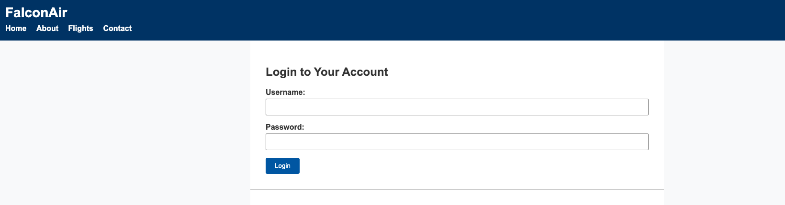

<h1>
  <span class="headline">Finding Elements Using Selenium</span>
  <span class="subhead">Using Basic Locators</span>
</h1>

**Learning Objective:** Use find_element() and find_elements() with By.ID, By.CLASS_NAME, By.TAG_NAME, and By.CSS_SELECTOR.

## Selenium’s `find_element()` and `find_elements()` methods

When you automate web browsers with Selenium, one of your first tasks is to _find_ the elements you want to interact with. These could be input fields, buttons, links—almost anything you see in a browser.

Selenium provides two essential methods:

- `find_element()`: Fetches the _first_ element matching your criteria.
- `find_elements()`: Returns a _list_ of all elements matching your criteria.

> 💡 Think of it like performing a search in a database:  
> `find_element()` is like searching for one specific record by ID,  
> while `find_elements()` is like gathering all records with a certain attribute.

For example, when writing a script to log in to a website, you need to find and fill out the username and password fields, and click the submit button. Each of these steps involves selecting the right element using one of Selenium’s locator strategies.

## Targeting elements by ID

In HTML, an _ID_ should be unique for each element on a page. Selecting by ID is usually the fastest and most reliable way to find exactly what you want.

> 🏆 Best practice:  
> If you can use an ID to find an element, do it. It is efficient and makes your code easier to read.

Suppose you want to fill in a username field with `id="username"`:

```python
username_input = driver.find_element(By.ID, "username")
username_input.send_keys("example_user")  # Types 'example_user' into the field
```

You know that only one element can have that ID, so you can interact with it confidently.

## Selecting elements by class name

A _class_ groups elements that share a style or a common purpose. Multiple elements can—and often do—share the same class name.

Use class names to work with lists or repetitive patterns on a page, like every product marked as "featured".

```python
featured_items = driver.find_elements(By.CLASS_NAME, "featured")
for item in featured_items:
    print(item.text)  # Prints the text of each featured item
```

Searching by class is like grabbing every item on a shelf labeled with the same tag—useful when the items are similar, but not unique.

> ⚠️ If you use `find_element()` with a class name, Selenium will only give you the _first_ match it finds.

## Locating elements with tag name

All HTML elements have a tag, such as `input`, `button`, or `a` (for links). Sometimes, you want to select all elements of a particular type.

For example, to gather all the links on a navigation menu:

```python
nav_links = driver.find_elements(By.TAG_NAME, "a")
for link in nav_links:
    print(link.get_attribute("href"))  # Prints each link’s destination
```

> 💡 This approach is useful for broad sweeps—like listing all images or links—but can return many elements, so use it with purpose.

## Using CSS selectors for flexible targeting

_CSS selectors_ let you mix and match rules to target nearly any kind of element. You might select an element by its ID, class, tag, or by a combination.

> 🧠 CSS selectors are especially powerful—think of them as the “universal remote control” for navigating HTML.

Common patterns in CSS selectors:

- By ID: `#login-form`
- By class: `.btn`
- By tag: `input`
- By attribute: `[type="submit"]`
- Combined: `.menu a` (all links inside elements with class "menu")

**Practical example:**  
Suppose you want the main login button, which is a `<button>` with class `"primary"`:

```python
login_button = driver.find_element(By.CSS_SELECTOR, "button.primary")
login_button.click()  # Clicks the login button
```

**Translating from DevTools:**

When exploring in DevTools, right-click any element and select **Copy selector** for a ready-to-use CSS selector.

<div class="activity guided-walkthrough">
  <h2 class="title">Applying each locator type</h2>
  <span class="minutes">10 min</span>
</div>

Let’s pull it all together with a hands-on activity using the FalconAir mock site.



<br>

**Our practice tasks:**

- Locate the **username input** by its **ID**.
- Select **both login form input fields** by their shared **class** name.
- Target the **login button** by its CSS **class**.
- Grab **all nav links in the main menu** using a **descendant** selector.
- Locate each **“Book Now” button** inside the available flights section.

> You can test each by running them in your `test_flight_page.py` and logging them to the console.

```python
# Login form
username = driver.find_element(By.ID, "username")
inputs = driver.find_elements(By.CLASS_NAME, "input-field")
login_button = driver.find_element(By.CSS_SELECTOR, "button.primary")

# Navigation links
nav_links = driver.find_elements(By.CSS_SELECTOR, ".main-menu a")

# All book buttons in the results section
book_buttons = driver.find_elements(By.CSS_SELECTOR, ".flight-card .book-btn")
```

> 💡 Tip: Use Chrome DevTools to inspect elements, test selectors live, and refine your locator strategy.

> 🔍 Try modifying a selector to make it more specific (ex: selecting the login button only within the login form).

## Best practices in choosing locators

How do you pick the best locator for your task? Consider these guidelines:

- **Prefer IDs**: Use IDs if they exist—they’re unique and quick to select.
- **Class names**: Good for groups or repeated components, but the site’s design may change.
- **Tags**: Use with care, since there may be many elements of one type.
- **CSS selectors**: Reach for these if you need more specificity or want to combine multiple attributes. Keep your selectors succinct and readable.
- **Test in DevTools first**: Validate that your locator targets what you expect.
- **Favor maintainability**: Write selectors that are robust to page updates—avoid depending on deeply nested structures.
- **Avoid XPath (for now)**: Use only if CSS selectors absolutely cannot accomplish the task.

> 🏆 A strong locator strategy means fewer bugs and more reliable automation scripts.

<div class="activity discussion">
  <h2 class="title">Reflect</h2>
  <span class="minutes">2 min</span>
</div>

How did your approaches to building CSS selectors differ from class name or ID selection? Were any elements trickier to target with one method versus another? Which locator felt most intuitive for you, based on the sample page structure?
